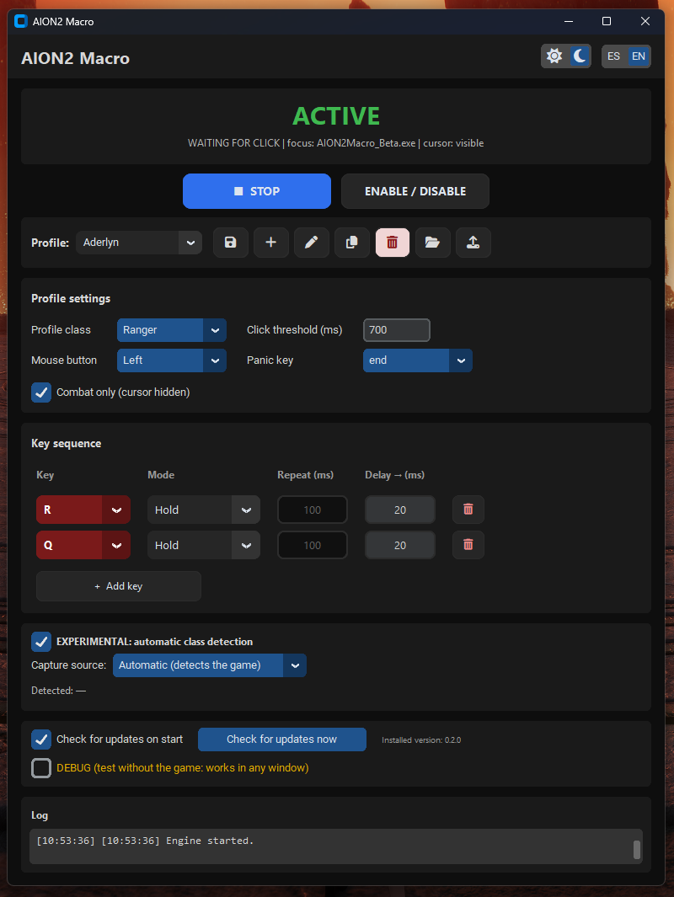

# AION2 Macro

Utilidad de **comodidad** para **AION2** (no es AFK, no automatiza el juego).

Mientras **sostienes un botón del mouse** (izquierdo o derecho) apuntando a un enemigo, el programa ejecuta automáticamente la **secuencia de teclas/clicks** que tú elijas (por ejemplo `R` y `Q`), **según el modo de cada una**: mantenerla pulsada, repetirla cada X ms o un solo pulso por click. Así el *"click → target → skill"* funciona sin tener que pulsar las skills a mano.

> **Filosofía / ToS:** pensado para usarse **mientras juegas activamente**. La política de NCSoft **tolera** el *skill-weaving* manual asistido; lo que **banea** es AFK, scripts, automatización total y RMT. **Nunca lo dejes en AFK.**

---

## Características

- **CLICK sostenido → secuencia**: al mantener el botón del mouse salen las teclas/clicks que configures, **cada una con su modo**:
  - **Mantenido** — deja la tecla pulsada mientras sostienes el click.
  - **Repetir** — pulsa/suelta cada X ms.
  - **Una vez** — un solo pulso por click.
- **Delay** configurable hacia la **siguiente** tecla de la secuencia.
- **Clics como teclas**: además de teclas, puedes asignar **CLICK IZQ.** / **CLICK DER.** (mismo driver HID).
- **Salida por FakerInput** (driver HID firmado): el input sale como dispositivo real (`flags = 0x0`), por eso el anticheat de AION2 lo acepta (a diferencia de AHK / `SendInput`).
- **Solo en combate**: opción para que las teclas salgan **solo cuando el cursor está oculto** (combate), y no en menús o chat.
- **Perfiles** ilimitados (uno por clase) + **compartir perfiles** (Exportar / Cargar `profiles.json`).
- **Guardado automático**: los cambios se guardan solos en `profiles.json`.
- **Tooltips** e **idioma en vivo** (**Español / English**), sin reiniciar.
- **Detección automática de clase** (experimental, **off** por defecto): lee tu clase de los **paquetes de AION2** (solo lectura, sin inyectar) y cambia solo al perfil de esa clase.
- Tema claro/oscuro y tecla de pánico (**END** por defecto).

---

## Requisitos

1. **Windows 10/11 x64** y permisos de **Administrador**.
2. **FakerInput** (driver firmado) — *no* viene incluido: https://github.com/Ryochan7/FakerInput
3. **Npcap** — solo para la detección automática de clase: https://npcap.com/ (suele venir ya con los medidores de DPS).

---

## Instalación

1. Descarga el ZIP de la **[última versión](https://github.com/crialero/aion2-macro/releases/latest)**.
2. Descomprímelo.
3. Entra a la carpeta **`AION2Macro`** y ejecuta **`AION2Macro.exe`** (acepta el UAC).
   - **No** saques el `.exe` de la carpeta (necesita la subcarpeta `_internal`).
   - La primera vez se crea solo `profiles.json` (tus ajustes).

---

## Uso

1. Elige un **perfil** (o crea/renombra).
2. Ajusta: botón del mouse, **secuencia de teclas/clicks** (con su modo y delay), umbral de click, etc.
3. Pulsa **Guardar** (o espera: se guarda solo) y luego **▶ Iniciar**.
4. Juega: al sostener el botón del mouse, salen las teclas/clicks según el modo de cada una.
5. **Pánico: END** (activa/desactiva el macro).

> **El host debe ejecutarse como Administrador** para poder leer el estado del click cuando AION2 tiene el foco (el juego corre en integridad alta y UIPI lo bloquea si no). El `.exe` ya trae el manifiesto `--uac-admin`.

---

## Perfiles

- Se guardan en **`profiles.json`** junto al `.exe` (o en `%APPDATA%\AION2Macro` si la carpeta es de solo lectura).
- **Regla:** cada clase real (Ranger, Cleric, …) solo puede estar en **un** perfil.
- **Compartir ajustes:** botón **Exportar perfiles** (genera un `profiles.json`) y **Cargar perfiles** (importa el de un amigo).

---

## Detección automática de clase

- Casilla **"EXPERIMENTAL: detección automática de clase"** (viene **desactivada**).
- **No depende de ningún otro programa** (ni de medidores de DPS): lee tu clase **directamente de los paquetes de AION2**, igual que un medidor, pero sin inyectar ni leer memoria.
- **Detecta solo**: el proceso del juego, el **adaptador** de red por el que sale y los **puertos** que usa (no asume un puerto fijo). Por eso funciona aunque uses **ExitLag/VPN** (captura el adaptador **Loopback**) o aunque el puerto sea distinto en tu PC.
- Para que detecte: entra a AION2 y **cambia de zona, teletranspórtate o cambia de personaje** una vez.
- **Fuente de captura:** `Automático (detecta el juego)` (recomendado), `Red (NIC)`, `Loopback (ExitLag/VPN)`, `Ambas`.

---

## Problemas frecuentes

- **El macro no hace nada al hacer click:** asegúrate de ejecutarlo **como Administrador** (si no, no lee el click con AION2 en foco).
- **No salen las teclas en el juego:** revisa que **FakerInput** esté instalado y que el perfil esté en **▶ Iniciar**.
- **No detecta mi clase:** necesita **Npcap**; cambia de zona/personaje una vez; si usas VPN/ExitLag deja la fuente en **Automático**.
- **Windows Defender marca el `.exe`:** es un falso positivo típico de PyInstaller. La **versión carpeta** casi nunca se marca. Si pasa, "Más información → Ejecutar de todas formas".

---

## Descargas

- **Última versión:** https://github.com/crialero/aion2-macro/releases/latest
- **Todas las versiones:** https://github.com/crialero/aion2-macro/releases

---

## Licencia

Este proyecto se distribuye bajo la **Licencia MIT** (ver [`LICENSE`](LICENSE)).

- Puedes **usarlo, modificarlo, compartirlo e incluso venderlo** libremente, siempre que conserves el aviso de copyright.
- Se ofrece **"tal cual", sin garantía** de ningún tipo (*"bajo tu propio riesgo"*). Es una herramienta de comodidad y su uso depende de cada persona: úsala bajo tu responsabilidad y respetando las normas (ToS) del juego.

---

## Créditos

- **FakerInput** (driver HID para enviar teclas/clicks) — MIT — https://github.com/Ryochan7/FakerInput
- **Npcap** (captura de red, opcional para la detección de clase) — licencia propia — https://npcap.com/
- **Font Awesome Free** (iconos) — CC BY 4.0 (iconos) / SIL OFL 1.1 (fuente) / MIT (código) — https://fontawesome.com
- **CustomTkinter** — MIT · **python-lz4** — BSD-2-Clause.
- Gracias a **A2Tools-DPS-Meter** por documentar el protocolo de AION2 (solo se usó información de formato; no se reutilizó su código).

---

Desarrollado por **Crialero**.
